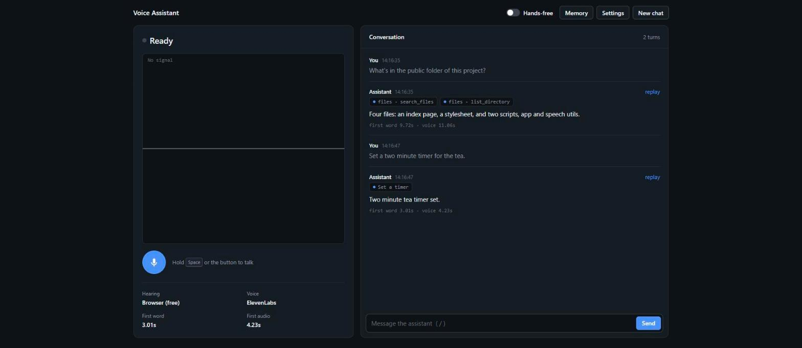

# Voice Assistant

[](https://github.com/oliver-mills/voice-assistant/actions/workflows/test.yml)

A personal, experimental project: a voice assistant in the browser that I built
to learn **ElevenLabs** voice APIs, **MCP** (Model Context Protocol) and the
**Claude API**. You hold <kbd>Space</kbd> and talk, and it talks back, using
tools from MCP servers along the way.



## What it does

- Push-to-talk or hands-free voice input
- Replies are spoken a sentence at a time as they stream in, and you can
  interrupt by talking over them
- Connects to MCP servers: in my setup it reads this project's files, drives a
  browser with Playwright, and looks at my GitHub repos
- Web search, timers, and a memory of facts you tell it
- Shows how long each reply took (time to first word and first audio)

## Stack

- **Node.js + Express**: backend, streams replies to the page with server-sent events
- **Claude API** (`@anthropic-ai/sdk`): the model, with tool use and web search
- **ElevenLabs**: speech-to-text (Scribe) and text-to-speech
- **MCP SDK** (`@modelcontextprotocol/sdk`): client for local (stdio) and remote (HTTP) MCP servers
- **Plain HTML/CSS/JS** frontend, Web Audio API for recording and the waveform
- **node:test** for tests, GitHub Actions for CI

## How to run

You need Node 22+, an [Anthropic API key](https://console.anthropic.com) and
an [ElevenLabs](https://elevenlabs.io) key (the free tier works).

```sh
git clone https://github.com/oliver-mills/voice-assistant.git
cd voice-assistant
npm install
cp .env.example .env              # add your keys and an ElevenLabs VOICE_ID
cp mcp.example.json mcp.json      # optional: the MCP servers I use
npm start
```

Then open <http://localhost:3000> in Chrome or Edge and allow the microphone.

- Hold <kbd>Space</kbd> to talk, or press <kbd>/</kbd> to type
- Settings lets you switch hearing and voice to the browser's free built-in
  ones, which saves ElevenLabs credits
- For the GitHub MCP server, add a read-only `GITHUB_TOKEN` to `.env`
- No Chrome installed? Add `"--browser", "msedge"` to the browser server's args in `mcp.json`

Run the tests with `npm test`. They use fakes and never call a real API.

## MCP setup

`mcp.json` uses the same format as Claude Desktop. I added two extra options
because it's a voice app and a misheard command shouldn't do anything
destructive:

- `tools`: only these tools are offered to the model
- `deny`: refuse any call whose arguments match, e.g. so it can never read `.env`

```json
{
  "mcpServers": {
    "files": {
      "command": "npx",
      "args": ["-y", "@modelcontextprotocol/server-filesystem@1.0.0", "."],
      "tools": ["list_directory", "read_text_file"],
      "deny": ["\\.env"]
    }
  }
}
```

## Things I learned

- Streaming matters most for voice: speaking each sentence as soon as it's
  finished cuts the wait from a whole reply to about one sentence
- Voice activity detection always reacts late, so hands-free keeps a rolling
  half-second of audio to avoid cutting off the first word
- ElevenLabs bills when audio is requested, not when it's heard, so it only
  fetches one sentence ahead of what's playing
- MCP tools can return huge results (a browser page snapshot is enormous), so
  results are capped before going back to the model

## Project layout

```
server.js           Express server, Claude turn loop, ElevenLabs proxy
mcp.js              MCP client
tools.js            Built-in tools (memory, timers)
public/             Frontend
test/               Tests
```
