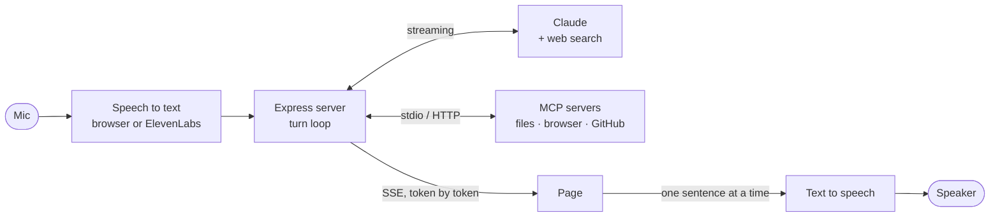

# Voice Assistant

[](https://github.com/oliver-mills/voice-assistant/actions/workflows/test.yml)

A voice assistant in the browser, built on Claude. Hold <kbd>Space</kbd> and
talk, or turn on hands-free and just speak. It answers out loud a sentence at a
time as the reply streams in, you can talk over it to interrupt, and it can use
tools from any [MCP](https://modelcontextprotocol.io) server: your files, a
browser it drives itself, your GitHub.


- **Thinking:** Claude, with web search for anything current
- **Tools:** an MCP client for local and remote servers, plus built-in memory and timers
- **Hearing:** the browser's own speech recognition (free), or ElevenLabs
- **Speaking:** ElevenLabs, or the browser's own voice (free)
- **Remembers** facts you tell it, and keeps the conversation across restarts

## How it works



A voice interface lives or dies on two things: how long the silence is after
you stop talking, and whether you can cut it off. Most of the work here is in
those.

**Speaking before the reply is finished.** Claude's reply streams to the page
over server-sent events. The page splits it into sentences as they complete,
without breaking `3.5` or `8.8 km`, and sends each one to text-to-speech while
the next is still being written. Audio starts about a sentence after you stop
talking, not a whole reply later. Under each reply are its measured timings:
when the first word arrived and when audio started.

**Interrupting.** Talking or typing over a reply cancels the turn: playback
stops, queued speech is dropped, and the server aborts the Claude stream so
the rest of the reply stops costing tokens.

**Hands-free that doesn't clip your first word.** A voice detector calibrates
to the room, then opens on speech and closes after a pause. By the time it is
sure you are talking, the first syllable has already passed, so recording runs
continuously through an AudioWorklet into a rolling half-second buffer, and
each clip starts from that buffer. Clips that were mostly noise (a cough, a
door) are dropped before anything is sent.

**Tools without surprises.** The MCP client gives each server an allowlist, so
a misheard command can't reach anything destructive, and `deny` patterns
refuse a call before the server sees it: the filesystem demo can never read
`.env`. Tool results are capped so a browser page snapshot can't cost thousands
of tokens on every later step, the tool list is prompt-cached, and every call
shows up as a step on the reply.

**Spending carefully.** It was built on ElevenLabs' free tier, so speech is
fetched one sentence ahead of what is playing (interrupting wastes at most
one), replies stop being spoken past 700 characters, the browser handles
hearing for free, and replays reuse the audio already fetched.

## Setup

Needs Node 22 or newer.

```sh
npm install
cp .env.example .env              # then fill in the keys
cp mcp.example.json mcp.json      # optional: the demo MCP servers
npm start
```

Open <http://localhost:3000> in Chrome, Edge or Safari. Firefox works too, but
has no speech recognition, so hearing always goes through ElevenLabs there.

| Key | |
| --- | --- |
| hold <kbd>Space</kbd> | Talk; talking over a reply interrupts it |
| <kbd>/</kbd> | Jump to the text box. Typing costs no transcription at all |
| <kbd>Esc</kbd> | Close a menu, or leave the text box |

| Variable | |
| --- | --- |
| `ANTHROPIC_API_KEY` | From console.anthropic.com |
| `ELEVENLABS_API_KEY` | From elevenlabs.io |
| `VOICE_ID` | An ElevenLabs voice, from the Voice Library |
| `ELEVENLABS_TTS_MODEL` | Optional. `eleven_flash_v2_5` is faster and cheaper; `eleven_multilingual_v2` (default) sounds better |
| `GITHUB_TOKEN` | Optional, for the GitHub MCP server. A fine-grained token with read access is enough |
| `HOST`, `APP_PASSWORD` | Optional. See [Running it beyond this machine](#running-it-beyond-this-machine) |
| `PORT` | Optional, default 3000 |
| `DATA_DIR` | Optional. Where history and saved facts live, default `./data` |

## MCP servers

`mcp.json` uses the same `mcpServers` format as Claude Desktop, so existing
setups copy across. Servers connect in the background at startup; one that
fails is reported in **Settings → Connected services** and the rest carry on.

```jsonc
{
  "mcpServers": {
    "files": {
      "command": "npx",
      "args": ["-y", "@modelcontextprotocol/server-filesystem@1.0.0", "."],
      "tools": ["list_directory", "read_text_file"],  // allowlist; omit for all
      "deny": ["\\.env"]                               // refuse calls whose arguments match
    },
    "github": {
      "url": "https://api.githubcopilot.com/mcp/readonly",
      "headers": { "Authorization": "Bearer ${GITHUB_TOKEN}" }  // read from .env
    }
  }
}
```

The example config sets up three servers that demo well:

| Server | Try saying |
| --- | --- |
| **files**: this project, read-only, `.env` and `data/` blocked | "What's in the public folder?" · "What does server.js do?" |
| **browser**: Playwright in a fresh, isolated profile | "Open Hacker News and read me the top three headlines" |
| **github**: GitHub's hosted server, read-only, repos, issues and PRs | "What issues are open on my voice assistant repo?" |

The browser server uses Chrome. Without Chrome, add `"--browser", "msedge"` to
its `args` to use Edge.

## Keeping ElevenLabs usage down

- **Hearing defaults to the browser**, which is free. ElevenLabs only gets the
  recording if browser recognition fails outright.
- **Voice: Browser** in Settings makes a session entirely ElevenLabs-free,
  which is the way to test changes.
- Speech is requested one sentence ahead of what is playing, so interrupting
  only wastes the sentence in flight.
- A reply stops being spoken after 700 characters (the rest stays in the
  transcript), and the server refuses any single request over 400.
- Hands-free ignores clips with little actual voice in them and trims trailing
  silence before anything is sent for transcription.

Tune these in `public/app.js` (`MAX_SPOKEN_CHARS`, `TTS_LOOKAHEAD`,
`VAD_MIN_VOICED_FRAMES`) and `server.js` (`MAX_TTS_CHARS`).

## Memory

Say "remember that..." and it saves the fact to `data/memories.json`, then
includes it in every conversation after. See and delete saved facts under
**Memory**, or ask it to forget. **New chat** clears the conversation but keeps
saved facts.

The conversation is kept in `data/history.json` (the last 40 messages).
`data/` is git-ignored and holds everything you have said to it, so treat it
as private.

## Running it beyond this machine

By default the server only listens on localhost. To reach it from elsewhere,
set `HOST` (e.g. `0.0.0.0`) and `APP_PASSWORD`; it refuses to start on a
non-local address without a password, since anyone who could reach it would
be spending your credits. The browser asks for the password once (any
username).

Browsers only allow the microphone on `https://` pages or localhost, so a
deployment needs HTTPS in front of it. Basic auth over plain HTTP sends the
password in the clear.

## Development

```sh
npm test
```

The tests never call a real API: they use fake keys, a fake `fetch`, and a
small fake MCP server over stdio.

| File | |
| --- | --- |
| `server.js` | Express server: streams Claude's replies over server-sent events, runs the turn loop and tool calls, proxies to ElevenLabs |
| `mcp.js` | MCP client: connects to the servers in `mcp.json`, allowlists, deny patterns, result limits |
| `tools.js` | Built-in tools: `remember`, `forget`, `set_timer` |
| `store.js` | Reads and writes the JSON files in `data/` |
| `public/app.js` | Recording, hands-free detection, speech playback, the scope, the transcript |
| `public/speech-utils.js` | Pure helpers shared with the tests: sentence chunking, WAV encoding |
